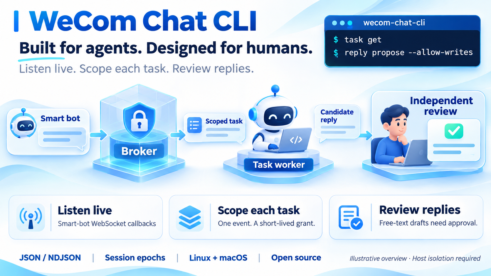

# wecom-chat-cli

<!-- readme-badges:start -->
[](https://github.com/AngelMsger/wecom-chat-cli/actions/workflows/ci.yml)
[](go.mod)
[](LICENSE)
[](https://angelmsger.github.io/wecom-chat-cli/)
<!-- readme-badges:end -->

> **Built for agents. Designed for humans.**



`wecom-chat-cli` connects coding agents and other agent hosts to **WeCom smart-bot
conversations**. A small broker maintains the long-lived WebSocket, turns incoming
messages into structured, explicitly untrusted events, and gives each conversation
worker a short-lived grant for exactly one task. The worker can propose an answer;
a separate operator reviews the exact draft before it is sent.

Use it when an agent needs to respond to employees or users without inheriting
administrator authority from their chat messages. The interface is framework-neutral:
hosts such as grok bot provide the worker runtime, thread history and reviewer.
The CLI supplies transport, task scope, session invalidation and reply enforcement.

**Documentation:** [angelmsger.github.io/wecom-chat-cli](https://angelmsger.github.io/wecom-chat-cli/)

**Status: published for Linux and macOS.** Native releases and npm packages are
available. Linux/macOS CI and synthetic Linux isolation checks pass.
Live WeCom tenant behavior and production deployment remain unverified.
See [verification](docs/verification.md) for evidence and limits.

## Features

- **Live smart-bot intake** — maintain the official WebSocket subscription,
  heartbeats and bounded reconnects, without a public inbound endpoint.
- **Scoped worker tasks** — read one granted event, with no inbox enumeration,
  recipient selector or route to self-approval. Plaintext grants are not persisted.
- **Separate conversations** — stable sender/conversation session keys, monotonic
  session epochs, serialized tasks and operator resets fence off stale results.
- **Independently reviewed replies** — immutable free-text drafts bind to the
  original callback, recipient, task and policy. Approval names the exact digest.
- **Bounded risk memory** — a worker reports risk for its own event; only the
  operator can quarantine or block a person. A false report cannot ban future messages.
- **Durable send outcomes** — persist the attempt before sending; interrupted or
  ambiguous outcomes are terminal and never automatically replayed.
- **Event-driven host delivery** — a separate trusted relay batches pending references,
  persists retries and request pacing, and supports explicit ACK or Grok routine
  HTTP acceptance. Supervisor claims deduplicate before business processing;
  [host integration](docs/host-integration.md#durable-webhook-delivery) explains
  the single-event grant boundary and deadline limits.
- **Agent-friendly interfaces** — JSON/NDJSON, fixed provenance, bounded cursors,
  structured errors and write previews follow the shared CLI conventions.
- **Companion Skill** — a checked-in `wecom-chat` guide describes the worker
  workflow, safe reply handling and limits for the host agent.

The broker enforces these capabilities outside the model. The host must still
isolate the worker's identity, tools, filesystem, network and memory. Pattern
screening does not guarantee injection detection or factual accuracy; see the
[security and deployment guide](docs/security.md).

## Alongside the official wecom-cli

This is an independent, purpose-specific companion to Tencent's
[official `wecom-cli`](https://github.com/WecomTeam/wecom-cli). It uses the published
[smart-bot long-connection protocol](https://github.com/WecomTeam/aibot-node-sdk).
The official CLI's remotely discovered services and each tenant's API availability
can evolve; the [assessment](docs/assessment.md) records what was actually checked.

| Tool | Primary role |
| --- | --- |
| Official `wecom-cli` | General WeCom operations through Tencent's supported CLI services |
| `wecom-calendar-cli` | Rolling calendar synchronization, local queries and agent-owned annotations |
| `wecom-channel-cli` | Channel/thread observation and independently reviewed channel actions |
| `wecom-chat-cli` | Live smart-bot conversations with event-scoped tasks and an enforced reply boundary |

Preserve existing bot integrations and official CLI credentials during setup.
A competing long-connection subscriber can displace a bot connection; use a
dedicated test bot for initial verification. The CLI does not import another
CLI's private credentials, reset bot secrets or create enterprise-wide chat access.

## Installation

Install the npm package with Node.js 20 or newer on Linux or macOS:

```sh
npm install -g @angelmsger/wecom-chat-cli
wecom-chat-cli version
```

Alternatively, build from source with Go 1.25 or newer; `go.mod` selects the
pinned build toolchain:

```sh
git clone https://github.com/AngelMsger/wecom-chat-cli.git
cd wecom-chat-cli
make build
bin/wecom-chat-cli version
bin/wecom-chat-cli --help
```

The examples below assume `wecom-chat-cli` is on your trusted setup session's PATH:

```sh
export PATH="$PWD/bin:$PATH"
```

`make cross` builds Linux/macOS amd64/arm64 executables. Version tags publish
native binaries with SHA-256 checksums and the `@angelmsger/wecom-chat-cli`
npm wrapper. The installer verifies checksums and never
downloads a missing binary implicitly during an agent command. See
[releasing](docs/releasing.md) for the publication contract. Upgrading from 0.2.x
to 0.3.x changes watch output and cursors; follow the
[migration procedure](docs/host-integration.md#migration-and-acceptance).

## Quick start

### 1. Provision the operator and broker

Obtain a dedicated API-mode smart bot's Bot ID and Secret from trusted WeCom
administration. Provision the separate service/worker identities, protected state
and socket directories using [the deployment guide](docs/security.md) and
[systemd reference](deploy/wecom-chat.service). The CLI does not install a service,
create accounts or sandbox the host automatically.

```sh
wecom-chat-cli auth guide
wecom-chat-cli config example
# Save and review the policy in an operator-controlled location.
wecom-chat-cli config validate --policy /etc/wecom-chat/broker.json
wecom-chat-cli broker serve --policy /etc/wecom-chat/broker.json --dry-run
```

The example policy denies all senders/groups until explicitly configured and uses
`reply_mode: review`. Obtain stable user IDs from trusted directory administration
or the official CLI's directory discovery (`wecom-cli contact --help`). Group IDs
must come from the trusted deployment owner. Display names and chat claims do not
establish identity or authority.

Supply `WECOM_CHAT_BOT_SECRET` only through the broker's protected service
environment, then deliberately start:

```sh
wecom-chat-cli broker serve --policy /etc/wecom-chat/broker.json
```

### 2. Receive a message and issue its task

The trusted supervisor reads the **operator** socket. Watches are bounded and
observe local pushed events; they do not poll the enterprise message archive.
Run the supervisor as ordinary code, with no model calls while idle. For webhook
delivery, use the separate [durable relay](docs/host-integration.md#durable-webhook-delivery)
as the collection owner instead of a second watch loop. A fresh watch
starts now and emits only references to live unassigned messages. Use `--replay`
for an intentional pending backlog, or `--cursor` to resume after durable host
enqueue. Reuse the cursor across bounded invocations, including idle ones.

```sh
wecom-chat-cli --socket /run/wecom-chat-operator/bridge.sock \
  --bot-id BOT_ID --deployment support event watch --duration 60s --max-events 100

wecom-chat-cli --socket /run/wecom-chat-operator/bridge.sock \
  --bot-id BOT_ID --deployment support task issue --event EVENT_ID --allow-writes
```

Use an event ID returned by the inbox. The issuance response discloses a secret
`task_token` once. Capture it programmatically without logging it or placing it
in the model's context, and provision `WECOM_CHAT_TASK_TOKEN` only to that worker's
tool executor. Lost delivery requires operator inspection, revocation and reissue;
a submitted draft cannot be replaced with a new grant.
Only then does the host submit a model job. The CLI has no built-in Grokbot job
API or webhook trigger; see [the interaction sequence](docs/host-integration.md#what-starts-a-model-task).

### 3. Let the worker read and propose

With its task environment provisioned, the worker uses only the **agent** socket:

```sh
wecom-chat-cli --socket /run/wecom-chat-agent/bridge.sock \
  --bot-id BOT_ID --deployment support task get

printf '%s' 'Please contact the service desk.' | \
  wecom-chat-cli --socket /run/wecom-chat-agent/bridge.sock \
  --bot-id BOT_ID --deployment support reply propose --allow-writes
```

There is no worker `--event` or recipient selector. In default review mode this
saves an immutable draft and sends nothing. If the task should be declined, use
`memory report --reason secret_request --allow-writes` with the same worker socket
and scope flags. Reports use fixed reason codes and affect only that event's
unsent reply path, never the author's future access.

### 4. Independently inspect and approve

An operator reviews the draft and recipient through the private socket:

```sh
wecom-chat-cli --socket /run/wecom-chat-operator/bridge.sock \
  --bot-id BOT_ID --deployment support reply get --event EVENT_ID

wecom-chat-cli --socket /run/wecom-chat-operator/bridge.sock \
  --bot-id BOT_ID --deployment support reply approve \
  --event EVENT_ID --digest REVIEWED_DIGEST --yes --allow-writes
```

`reply reject` uses the same event/digest/confirmation flags. The exact reviewed
text is sent to the original callback; approval cannot change its text or recipient.
Never give the worker the operator socket or implement a loop that blindly approves
its drafts. `sent`, `failed` and `uncertain` are terminal outcomes: inspect them
after interruption and never manufacture another event to retry a send.

## Configuration

Operator policy is separate from worker credentials. Validate it before starting
the broker; see `config example` for the complete version 2 schema.

| Setting | Purpose / default |
| --- | --- |
| `deployment`, `bot_id` | Exact broker scope; every client request must match |
| `state_dir` | Private, scope-bound durable ledger |
| `agent_socket`, `operator_socket` | Separate OS-protected interfaces with distinct authority |
| `allowed_users`, `allowed_groups` | Stable identity allowlists; empty by default |
| `reply_mode`, `templates` | Review by default; optional reviewed literal templates |
| `task_ttl_seconds`, `reply_ttl_seconds` | Both 120 by default; the task cannot outlive the event's reply deadline |
| `retention_seconds` | Raw incoming text and drafts expire after 24 hours by default |
| `max_events`, `per_user_per_minute` | Bounded storage and intake; defaults 10,000 and 20 |

The 120-second deadline is local policy, not a guarantee about the upstream reply
window. A shorter server window can reject a reply. Credentials never go in the
policy: the broker receives `WECOM_CHAT_BOT_SECRET`; an isolated worker's executor
receives only `WECOM_CHAT_TASK_TOKEN`. Neither belongs in argv, logs or chat history.
Client connection flags are explicit; this CLI has no named-context or worker-login command.

## Sessions and host integration

Map `(session_key, session_epoch)` to the host's thread and isolated memory.
The session key includes deployment, bot, conversation type/ID and sender; different
people in the same group have different worker contexts. A group reply remains
visible to the group, so private information must not enter its worker context.

Only one unfinished task is active within a session. A reset requires the current
epoch and invalidates old grants/proposals; subsequent events get a new epoch.
Revocation, blocked users, expiry, policy changes and broker/connection restarts
also invalidate stale grants. Already-read content cannot be recalled.

The host supplies the durable job queue, sandbox, model execution, thread lifecycle
and independent reviewer. No concrete grok bot SDK adapter is bundled. See
[host integration](docs/host-integration.md) for the supervisor sequence and wire protocol.

## Reply policies

| `reply_mode` | Worker input | Sending authority |
| --- | --- | --- |
| `review` (default) | One immutable free-text draft | Independent operator approval of the exact digest |
| `template` (explicit opt-in) | A configured template ID | Broker sends the exact reviewed literal, with no interpolation |
| `disabled` | Task reads and risk reports only | No sends |

Template mode uses `reply propose --template TEMPLATE_ID --allow-writes`; task
reads list the available IDs. There is no unrestricted automatic free-text mode.
Configure only harmless public templates suitable for every admitted recipient;
the broker cannot guarantee the model selects an appropriate one.

## Commands

| Command | Role | Purpose |
| --- | --- | --- |
| `auth guide`, `config example`, `config validate` | Local setup | Credential guidance and protected policy validation |
| `broker serve` | Operator service | Maintain WebSocket intake and worker/operator sockets |
| `status` | Operator | Connectivity, scope and coverage |
| `event list` / `get` / `watch` | Operator | Full audit reads; quiet-by-default pending reference stream |
| `task issue` / `revoke` | Operator | Create or revoke an event-scoped worker grant |
| `task get` | Worker | Read only the granted task |
| `reply propose` | Worker | Submit a draft or select a policy-approved literal |
| `reply get` / `approve` / `reject` | Operator | Inspect and decide on an exact draft digest |
| `session reset` | Operator | Advance an expected epoch and invalidate old work |
| `memory report` | Worker | Report a fixed risk reason for its event |
| `memory list` / `set` | Operator | Inspect or set quarantine/block/watch/clear records |
| `version` | Local | JSON version, commit and build time |

The [generated command reference](docs/cli/README.md) lists all flags and matches
`--help`. Run `make docs` after changing the command tree.

## Agent output and safety modes

External records retain a fixed `trust` envelope with `content_trust:
"untrusted_external"`, `instruction_authority: "none"` and
`host_actions_authorized: false`. Preserve that provenance with the content.
There is no raw/table output or field projection that strips the boundary.

Lists follow `{items, next, has_more}`. Reuse `next` as `--cursor` with the same
broker/policy; NDJSON emits records on stdout and pagination notices on stderr.
A watch cursor is an output checkpoint, not proof of successful model execution.
The terminal notice labels it `checkpoint_stage: emitted`, with an `emitted` count.
The host must durably deduplicate/enqueue before saving progress and keep job results
separately. Watch references omit message bodies; `task get` reads authorized
content on demand. Old watch/list cursors require an explicit
[migration](docs/host-integration.md#migration-and-acceptance).

Mutations accept `--dry-run`. Applying a client mutation requires
`--allow-writes`; approval/rejection, revoke, session reset and operator memory changes
also require `--yes`. Those flags express invocation intent and never grant
operator authority. Only the operator can change a user's memory status:
`blocked` is indefinite, `quarantined` lasts one hour and `watch` one day.

## Errors and exit codes

Errors are structured JSON on **stderr**; stdout remains the data channel.
The shared `agent-cli-kit` contract maps categories to stable exit codes:
`0` success, `1` internal, `2` usage, `3` config, `4` auth, `5` permission,
`6` not found, `7` rate limit, `8` network, `9` server, `10` parse, `11` conflict.

Respect the error's code, recovery guidance and durable task/proposal state.
A network failure does not establish that a write failed. Inspect `reply get` or
`event get` through the operator before deciding what happened; an uncertain
send is never automatically replayed. Raw upstream diagnostics and credentials
are not exposed through the worker interface.

## Companion Skill

The [wecom-chat Skill](skills/wecom-chat/SKILL.md) teaches the worker to read its
granted task, propose one response or report risk. Install that matching guide
through the host's skill mechanism and reload its worker context after upgrades.
The future npm wrapper includes the matching guide; the current CLI has no
`skill install` command or automatic host integration.

## Scope and compatibility

Only this bot's live callbacks are observed. There is no enterprise chat archive,
disconnected-message backfill, exactly-once host execution or token-by-token reply
stream. Quotes/media are suppressed and links are never fetched. The broker does
not provide arbitrary file access, tool dispatch, user impersonation or a host sandbox.

Version 1 policies require explicit migration to version 2: replace
`enable_replies` with `reply_mode`, add `task_ttl_seconds` and `templates`, and
review the operator/worker split. `reply send` and `memory flag` are removed.
Version 1 ledgers migrate while preserving deduplication history, memory and send
outcomes; legacy epoch-zero events cannot receive new grants. Keep a protected
backup and never roll a migrated ledger back to an older binary.

Retained tombstones protect against duplicate sends. The 10,000-event/64-MiB cap
stops intake rather than deleting replay history; safe long-term archival and
high-volume operation remain future work. See [technical design](docs/technical-design.md).

## Development

```sh
GOWORK=off make lint test e2e build docs-check site-check release-tests
npm test --prefix build/npm
GOWORK=off make vuln
make cross       # Linux/macOS amd64 and arm64 binaries
make docs        # CLI Markdown, narrative HTML and sitemap
```

CI runs on Linux and macOS, with a separate network-disabled Linux isolation job.
Tests use synthetic credentials and conversations; no live WeCom messages are sent.
The optional local container runner is documented in [verification](docs/verification.md).

Use a branch and pull request for changes. Read [CONTRIBUTING.md](CONTRIBUTING.md),
[SECURITY.md](SECURITY.md) and the [release guide](docs/releasing.md). npm trusted
publishing uses the package's GitHub Actions publisher binding.
A release tag is a deliberate publication action, not a test.

## Documentation

| Guide | Contents |
| --- | --- |
| [Online documentation](https://angelmsger.github.io/wecom-chat-cli/) | Product overview, interactive examples and searchable commands |
| [Command reference](docs/cli/README.md) | Generated commands, roles and flags |
| [Host integration](docs/host-integration.md) | Supervisor sequence, sessions and worker protocol |
| [Security and deployment](docs/security.md) | Trust model, OS identities, permissions and live acceptance |
| [Technical design](docs/technical-design.md) | Intake, grants, approvals, persistence and migration |
| [Assessment](docs/assessment.md) | Official API evidence, intended scope and family differences |
| [Verification](docs/verification.md) | Completed checks and remaining live-deployment limits |
| [Releasing](docs/releasing.md) | GitHub Pages, native artifacts and npm OIDC |
| [Changelog](CHANGELOG.md) | Version history |

## Related

Part of a family of agent-facing CLIs — shared conventions and a common kit,
with each tool enforcing the boundaries its service requires. Browse the family
at **[github.com/AngelMsger](https://github.com/AngelMsger)**:

- **[jira-cli](https://github.com/AngelMsger/jira-cli)** — Jira issues and workflow transitions
- **[confluence-cli](https://github.com/AngelMsger/confluence-cli)** — Confluence as a knowledge base
- **[bitbucket-cli](https://github.com/AngelMsger/bitbucket-cli)** — pull requests and code review
- **[openobserve-cli](https://github.com/AngelMsger/openobserve-cli)** — logs, metrics and traces
- **[jenkins-cli](https://github.com/AngelMsger/jenkins-cli)** — jobs and builds
- **[prometheus-cli](https://github.com/AngelMsger/prometheus-cli)** — queries, targets, rules and alerts
- **[wecom-calendar-cli](https://github.com/AngelMsger/wecom-calendar-cli)** — local calendar history and annotations
- **[wecom-channel-cli](https://github.com/AngelMsger/wecom-channel-cli)** — channel/thread observation and reviewed actions
- **wecom-chat-cli** — scoped smart-bot conversations *(this project)*

Shared behavior comes from [agent-cli-kit](https://github.com/AngelMsger/agent-cli-kit).

## License

Released under the [MIT License](LICENSE). This independent project is not
affiliated with or endorsed by Tencent.
