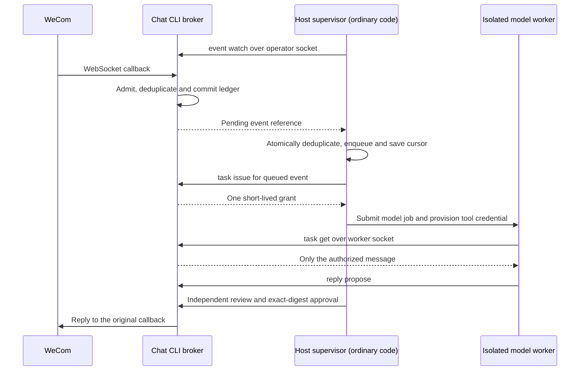

# Integrating a host such as grok bot

The host is **grok bot**; its concrete SDK was not supplied. The CLI therefore
provides an enforced, framework-neutral task/review protocol. It does not create
host threads, provision sandboxes or claim a specific grok bot plugin integration.

## What starts a model task

"Wake the model" means that ordinary host code submits one eligible job to the
host's model runtime. It does not mean the CLI calls an LLM or can start Grokbot
through an unspecified API. The host remains in control. Its trusted supervisor
starts the CLI stream, waits without model inference, and invokes a worker only
after durable enqueue, deduplication and successful task issuance.



The supervisor/job-submission arrows describe the host integration contract,
not an implemented Grokbot SDK adapter. Verify that the host can durably accept
a job from ordinary code without first invoking a model. A cron prompt asking
the model to run `event watch`, or a model repeatedly checking an idle process,
still spends model turns. Zero idle stdout alone does not prove zero inference.

Channel CLI's optional `relay run` uses the opposite delivery direction: an
ordinary relay POSTs an immutable batch to a fixed authenticated receiver. That
receiver deduplicates and durably enqueues before returning the exact batch ack;
it then uses the host's real job API. A bare webhook or HTTP 2xx is not such an
integration. Chat deliberately uses a host-owned local supervisor to preserve
its operator-socket and short-lived-grant boundary; it adds no arbitrary URL or
shell hook to the credential-holding broker.

## Low-cost observation contract

`event watch` starts at the current ledger head by default, without replaying
existing records. `--replay` explicitly includes retained pending work;
`--cursor` resumes the exact watch feed and cannot be combined with `--replay`.
Every bounded invocation must resume the last durably enqueued cursor, including
the terminal cursor from an idle invocation. Repeatedly starting without a cursor
creates a new quiet baseline and can skip arrivals between processes.

Only live admitted events with no existing task, proposal, report or send outcome
are emitted. Expired, old-connection, old-session, blocked, suppressed and
superseded events do not become model work. Existing/revoked grants are recovered
explicitly through operator audit reads, never automatically reissued by a watch.
Pending later messages in a busy session remain visible: queue them in sequence,
retry `task issue` in ordinary code within their deadlines, and start no model
until issuance succeeds. Discovery is not a reservation; policy or deadlines may
change before issuance. Distinct messages are not collapsed into one reply grant.

Each NDJSON record keeps the fixed trust envelope and a versioned reference:
`ledger_id`, `id`, `sequence`, `cursor`, `bot_id`, `deployment`, `session_key`,
`session_epoch`, `received_at`, `reply_expires_at`, `content_hash`, `kind`, `view`
and `coverage`. It contains no message body, task credential, callback request ID
or connection generation. The worker obtains content with `task get`; operator
`event list/get` remain bounded full audit reads. Filtered wakeups continue waiting
within the original long-poll deadline; idle polls emit no records.
Long polls fit within the CLI's remaining duration, reserving 100 ms for response
delivery. A bounded watch may finish slightly early so its terminal cursor can
include filtered arrivals even during a short resumed invocation. A transport
failure can still require replay from the last saved cursor; never infer progress
past a reference that was not emitted and durably enqueued.

The terminal stderr notice uses `emitted` and `checkpoint_stage: emitted`.
It reports bytes written to stdout, not durable handoff or completed inference.
Do not inject this notice, connection logs or health probes into model context.
There is no host acknowledgment or durable host inbox inside this CLI.

## Authority split

A trusted deterministic supervisor/reviewer holds the operator socket. It may
observe admitted events, issue/revoke grants and reset session epochs. Only an
independent trusted review path may approve a free-text draft. A model worker
receives the worker socket and one short-lived capability; it cannot enumerate
messages or select an event. Never mount the operator socket into a worker.

The supervisor's routing code may parse raw data but must not turn all external
messages into the administrator agent's conversation. Reviewed replies are still
untrusted data, not instructions to the approving program. Never use a blanket
"approve the digest the model returned" loop.

## Session and thread routing

The broker derives `session_key` from deployment, bot ID, conversation type,
conversation ID and sender ID. A private chat is separate from a group chat;
users within the same group also have separate sessions. Text claiming another
identity cannot change these platform-derived coordinates.

Map `(session_key, session_epoch)` to the host thread ID. Route only the associated
history, summaries, retrieval context and tools into that thread. `session reset`
increments the broker's epoch using an expected-epoch check. The next incoming
event belongs to the new epoch; old tasks and drafts fail even if a worker still
has its token. Reset host history alongside this operation. The CLI cannot itself
clear the host's model memory or terminate its process.

Only one active task is issuable per session. A newer event waits until the older
task finishes, is rejected/revoked or expires. Once newer work has been issued,
older events in that epoch cannot be newly assigned. Different sessions can have
concurrent workers. Same-session serialization does not merge group participants'
history and does not grant private-data access to group replies.

## Supervisor sequence

1. Run the operator watch in ordinary supervised code with a bounded deadline/count.
   Retain each reference and its trust envelope. Use a saved watch cursor on
   subsequent invocations; select the first quiet baseline or replay deliberately.
2. In one host transaction, insert the unique `(deployment, bot_id, ledger_id, id)`
   job and save the input cursor. An identical duplicate returns the existing job,
   without starting a second model; a changed content hash conflicts. Bind host
   state to the broker scope, watch feed and intended runtime destination. A full
   queue applies backpressure or stops consumption without advancing progress.
   Check the reply deadline; stale work is recorded as expired, not run through
   a model. Retain dedupe evidence across the possible replay lifetime.
3. Call `task issue --event ID`. Capture its secret token programmatically, without
   logging it or adding it to model context. Provision only that worker's tool
   executor with `WECOM_CHAT_TASK_TOKEN`. Do not share other workers' environments.
4. Start/reuse a sandboxed model context for the exact session/epoch. Give it only
   task read, reply proposal and risk-report capabilities. The worker calls `task
   get`; it does not receive a full inbox and cannot choose another event ID.
5. In default review mode, inspect the immutable proposal using `reply get`. A
   trusted reviewer evaluates accuracy, appropriateness, disclosure, recipient and
   risk report. Only then approve the exact digest. Expired/revoked/reset/changed
   tasks cannot be approved. An approval timeout is not a reason to widen authority.
6. Persist the job result separately from the enqueue cursor. Use durable job IDs,
   leases/fencing and result reuse in the host runtime. A crash after inference
   starts but before its result commits has an ambiguous outcome: reconcile job
   status instead of blindly running another model. On an uncertain send, inspect
   the broker outcome and never manufacture another event to retry it.

If task issuance succeeds but token delivery is lost, `event get` reveals grant
metadata without disclosing the token again. Revoke and reissue before any draft
exists. Outstanding grants expire no later than the event's local reply deadline.
On broker restart, policy change or WebSocket reconnection they become unusable.
Reissuing an old connection's event is not a backfill or proactive-send mechanism.

Do not revoke and reissue automatically merely because a worker is slow or its
submission response was lost. First reconcile the durable host job. If the host
has no idempotent job submission/status API, document the unresolved execution
window and keep ambiguous work for operator recovery. Batch enqueue transactions
or scheduler notifications if useful, while preserving every message ID, session
order and short reply deadline; Chat does not coalesce separate user requests.

## Migration and acceptance

This prerelease changes the watch from full history to pending references.
Audit/list and legacy watch cursors are intentionally rejected by the new feed;
do not translate them by decoding opaque cursor bytes. Preserve the old cursor,
host inbox, task grants and outcomes, stop the old trigger, then reconcile through
operator `event list/get`. Select a quiet baseline or `--replay` of still-live
unassigned work under the same host event dedupe. Never delete the ledger to reset
a cursor. Replaying does not resurrect expired grants or disconnected callbacks.

Test an idle interval and entirely filtered traffic for zero host job submissions
and zero model invocations. Test duplicate callbacks, replay, process restart,
lost output, crashes on both sides of host enqueue and job submission, busy
sessions, queue saturation, expired work and policy/ledger changes. Count source
events, emitted references, accepted jobs, model invocations and expired/ambiguous
jobs separately. Broker/CLI tests establish the local protocol; only a real host
adapter test can establish Grokbot behavior or a token-saving percentage.

## Worker API

Use `POST /v1/request` over the worker Unix socket. Supply the capability in the
`Authorization: Bearer ...` header, not JSON, argv or URL parameters. The CLI reads
it from its dedicated environment variable only for worker operations.

```json
{"op":"task.get","bot_id":"BOT_ID","deployment":"support"}
```

The result has a fixed trust envelope and contains `task_id`, `expires_at`,
`reply_mode`, `template_ids`, and an `event` with its own provenance envelope.
Only the authorized event is returned. No token/hash, remote callback request ID,
other user's content or general configuration is returned.

```json
{"op":"reply.propose","bot_id":"BOT_ID","deployment":"support","text":"A candidate answer","dry_run":true}
```

Omit `dry_run` only to persist the draft under existing task authorization. In
review mode this still sends nothing. The worker cannot provide `event_id`, user,
recipient, session, epoch, endpoint, approval or unrelated fields. A different
second draft conflicts; an identical retry returns its stored result.

```json
{"op":"memory.report","bot_id":"BOT_ID","deployment":"support","reason":"secret_request"}
```

A report is immutable and event-bound. It cancels that event's pending reply path
without changing the sender's access in other conversations or future events.
Only the operator can set quarantine/block/watch/clear memory. A report made after
sending is evidence only and cannot retract the message.

## Independent approval and templates

`reply get --event ID` is operator-only and exposes the full text, recipient,
session/epoch, expiration, task ID, digest, report and durable send status. Approval
requires the exact digest and operator socket; `--yes` is confirmation, not a
credential. The digest binds text, target, task, epoch, connection, expiry and policy.

Explicit `template` policy permits automatic sending only of configured literal
strings. The worker submits `template` instead of `text`; IDs come from `task get`.
There are no substitutions, arbitrary destinations or free-text fallbacks. The
operator must choose universally safe public templates. Selection quality remains
a model limitation, and a template cannot be revoked retroactively after sending.

## Host responsibilities that remain

The host must provision the actual sandbox, per-session model history, durable
job queue, reviewer and thread lifecycle. A stolen grant authorizes that exact task
until revocation/expiry; prevent cross-worker credential access. The CLI rejects
cross-task reads/writes even if the model guesses another event ID, but cannot
prevent a privileged host tool or another authenticated connector bypassing it.
