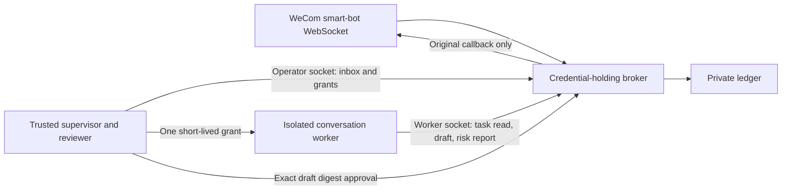

# Technical design

Version 2 moves task targeting and send authorization out of the conversation model.
The default policy must remain safe when a worker obeys an injected instruction.

## Boundaries and roles

The agent socket is a capability-authenticated worker interface. It does not expose
a general inbox, even to a worker presenting a valid grant. The operator socket is
OS-protected and belongs only to trusted supervisor/reviewer code or a human, not
an LLM worker. Tokens cannot select operator authority, and operator requests cannot
impersonate a worker operation. The host must still isolate tools, memory and data.

One bot/deployment has a private ledger and two sockets. A single broker can issue
many event-scoped grants without sharing their data. The trusted broker/operator
remain trusted across all those tasks. Never run competing subscribers to one bot
expecting horizontal scaling; upstream displacement stops this service.

## Packages

`cmd` contains the executable and deterministic doc generator. `internal/app`
wires Cobra, kit output/errors/argv handling and environment-only task credentials.
`internal/config` validates strict version 2 operator policy. `internal/broker`
owns admission and socket roles; `tasks.go` owns capability/review enforcement.
`internal/state` owns the locked atomic ledger and schema migration;
`internal/securefs` checks every trusted path ancestor. `pkg/aibot` implements the
small WebSocket subset; `pkg/safejson` rejects ambiguous/deep/invalid JSON.
`internal/relay` owns an independent metadata outbox and supervisor claim ledger;
its sender never creates task grants. `pkg/transport` re-exports the kit with
redirect-free, single-attempt POST defaults.
Filesystem/JSON helpers retain the Channel CLI's MIT attribution.

The shared kit is pinned to v0.9.0. Chat uses its errors, output, argv normalization
and HTTP transport for relay POSTs. Upstream intake retains the dedicated
WebSocket client; local Unix-socket requests explicitly refuse redirects. Webhook
POSTs disable request-body replay even with `Idempotency-Key`; only the persisted
relay state machine can authorize another attempt. Go 1.27.4 includes the current
net/http security fix.

## Transport

The endpoint is fixed, with TLS verification and configured HTTP proxy settings.
Credentials are sent after a successful WebSocket handshake. Subscription requires
an exact request ID and explicit success code. Frames are limited to 64 KiB; a
single reader dispatches callbacks through a bounded 128-record queue and routes
acknowledgements to exact pending request IDs. Writes serialize.

JSON heartbeats run every 30 seconds with a five-second acknowledgement deadline.
Transient transport loss reconnects with jittered exponential backoff below 60
seconds. Authentication rejection, displacement, failed durable intake or queue
exhaustion stops the service. Shutdown waits for connection work before releasing
the state lock. No automatic supervisor restart should undo a displacement stop.
No upstream error bodies, URLs, headers or credentials appear in diagnostics.

Only live callbacks are observed. Disconnection is a coverage gap, not guaranteed
upstream replay. Replies are single final stream frames. The 120-second default
reply TTL is local policy, not an assertion about the upstream validity window.
A shorter upstream window may reject a reply. Accurate host time is required.

## Admission, sessions and sequencing

Validate bot/message/sender/conversation identity, require allowlisted senders and
additional group admission, then deduplicate by bot/message ID. Keep the first
payload, callback request ID and connection generation immutable. Suppress blocked
users, unsupported quotes/media, oversized messages and excess per-user traffic.
Heuristic screening detects conspicuous injection/credential/destructive patterns;
it never labels passing text trusted or grants capabilities.

Only admitted text is stored raw. Suppressed/quarantined content keeps its digest
and fixed reason codes. Each accepted record gets a monotonic sequence. Its stable
session key hashes deployment/bot/chat type/chat ID/sender. The ledger also binds
its session epoch, initialized to one. Admission and its epoch are one transaction;
long-poll readers wake only after the commit.

An operator reset requires an event identifying the session and the expected
current epoch. A successful increment invalidates all old grants and proposals.
A duplicate reset with the old expected epoch conflicts instead of incrementing
again. Future incoming events carry the new epoch. Host model histories must use
`(session_key, session_epoch)`; the broker cannot erase another system's memory.

Issuance serializes active work within a session. A newer event cannot be issued
while older work is live and unfinished. Once a newer event has a task, older
unassigned events cannot be issued in that epoch. Rejection, revoke, expiry or a
terminal send or risk report releases serialization. Different sessions can progress
concurrently.

## Local protocol

HTTP over Unix socket, `POST /v1/request`, maximum 32 KiB, eight concurrent requests
per listener. Every request requires the expected bot/deployment. Unknown JSON
fields, duplicate keys and fields unrelated to the selected operation fail, even
on dry-run. Neither URL parameters nor request bodies can select authority.

Worker-only operations are `task.get`, `reply.propose`, `memory.report`.
Operator-only operations are `status`, `event.list/get/watch`, `task.issue/revoke`,
`session.reset`, `reply.get/approve/reject`, `memory.list/set`.
Direct send and model-controlled quarantine have no API/CLI compatibility aliases.

The operator inbox uses limits 1..100 and waits 0..25 seconds. CLI watch uses
`event.watch`, repeating local long polls within explicit count/deadline bounds;
it never polls WeCom. A fresh watch pins the current ledger head; `--replay`
explicitly selects retained pending work. Its `pending_v1` feed returns metadata
references only for live, admitted, unassigned events. Assigned/revoked, closed,
expired, stale-session/connection and superseded work requires operator audit or
recovery rather than an automatic second model job. A busy session's later
unassigned events remain visible for the host queue; issuance still serializes them.
Filtered notifications do not finish a long poll or renew its deadline.
Pending discovery builds one latest-assignment index per nonempty snapshot scan.
The index uses the session's conversation type/ID, sender and epoch (bot/deployment
are fixed by the ledger), and includes revoked, expired and completed grants.
Each candidate then uses a constant-time lookup instead of scanning later events
and hashing their session keys repeatedly.

The watch protocol also accepts `wait_millis` in 0..25000, mutually exclusive with
nonzero `wait_seconds`; other operations reject this field. The CLI uses the
remaining observation budget minus 100 ms for returning the response, capped at
25 seconds. It stops polling when only this response budget remains, so a bounded
watch may return slightly early. Filtered progress reaches the client before its
request deadline under normal operation. A stalled/failed response still retains
the last known cursor; no progress beyond successfully emitted references is
inferred from cancellation.

Cursors bind ledger ID, policy digest, feed and sequence. They are checkpoints, not
credentials. Default reads omit suppressed/blocked records; `--include-suppressed`
allows operator list inspection of redacted metadata. Audit/list and legacy watch
cursors cannot be used in the pending feed. `event.get` is an operator audit
read. Expired raw text is hidden even before physical maintenance erasure.

Operator watch pages also expose `watch.identity` (bot, deployment, ledger),
`watch.binding` (policy digest) and `watch.after_sequence`. Relay validates these
alongside every reference before atomically saving the page cursor and outbox.
Existing clients keep using opaque cursors; they need not decode their internals.

The relay ports Channel's locked, fsynced atomic JSON snapshots, immutable batches,
explicit ACK/HTTP acceptance modes, receipts, retries and pacing. Configuration
and queue belong to a trusted service, independently of broker credentials and
supervisor processing state. Its binding covers socket, bot, deployment and the
entire delivery configuration. Pending references group by session plus epoch;
no distinct message is collapsed. Never-attempted expired notifications can be
removed with persisted counts; attempted payloads stay immutable. A claim stores
new event IDs and recoverable work atomically before returning any work, with
non-expiring claims and explicit completion. The host still owns job scheduling,
leases, token provisioning and recovery of ambiguous execution.

Hosts must durably enqueue/deduplicate and maintain their own execution checkpoint.
A watch cursor acknowledges emitted data, not successful model execution. Already
read content cannot be recalled by later revocation. Supervisors must not attach
inbox content to an administrator model conversation or auto-approve model output.
The CLI first obtains an immediate baseline before waiting, so even an idle bounded
invocation reports a concrete cursor. Its terminal notice says `emitted` and
`checkpoint_stage: emitted`. The host atomically enqueues/deduplicates references
before saving this cursor and tracks processing separately. The host, not this
broker, owns model-job submission, retries, leases and ambiguous-job recovery;
see the [host sequence and migration contract](host-integration.md).

## Task capabilities

Only the operator issues a task for a live admitted event. A token combines an
opaque event locator and 256 random secret bits; only its hash is persisted. The
authorization comparison is constant-time. The token is returned once in the
operator issue response and never in task reads, errors, audit views or logs.

The CLI obtains `WECOM_CHAT_TASK_TOKEN` only for worker operations and sends it in
the Authorization header. There is no token argv flag or JSON token field. A grant
binds the original event, sender/conversation, epoch, policy digest, current broker
instance, WebSocket generation and deadline (at most the event's reply expiry).
Checks run on every task read, proposal, report and pre-send validation.

The worker never chooses a target. Extra event/user/epoch/digest fields are rejected
on worker operations. Its task view contains only its event, mode, template IDs and
safe task metadata. Knowing another event ID, cursor or session hash grants nothing.
Workers must not share token environments or files; bearer theft still authorizes
the stolen task until expiration/revocation.

Lost grant delivery is recovered by inspecting the event, revoking and reissuing
before a proposal/report exists, with a cap of eight attempts per event. Tokens
are not recoverable from storage. Restarts and WebSocket reconnects invalidate
outstanding tasks; a previous connection's event cannot be reissued as a new send.

## Proposals and review

Policy modes are `review` (default), `template` and `disabled`. No automatic
free-text mode exists. In review mode a worker can persist one immutable final
text draft per event. Its digest binds text, target, task ID, epoch, expiry,
connection/request ID and operator policy. An identical submission returns the
existing draft; changed content conflicts. Dry-run uses the same validation without
state changes or external sends.

The operator reads the full draft/recipient/digest/report and separately approves
or rejects that exact digest. CLI approval/rejection requires `--yes` and explicit
write intent; the listener is the authority, not those flags. Rejection is terminal.
Approval cannot change text or recipient. Recheck current task policy, epoch,
connection, memory, report and deadline; the worker cannot approve itself.

Template mode must be explicitly configured with at most 16 reviewed literals.
The worker selects an ID only; no interpolation, caller text, unknown template or
free-text fallback is allowed. After validation and persistence, broker policy
permits the exact literal to send automatically. Templates are public material;
selection quality is not guaranteed. Disabled mode permits reading/reporting but
no proposal or approval-based send.

Text must be valid UTF-8, at most 4096 bytes and pass outbound control/credential
checks. Reflected bot credentials and task-token shapes are intercepted. These
checks do not establish truth, appropriateness or complete secret detection.

## Durable send outcomes

`unset -> sending -> sent | failed | uncertain`

The sole send function runs under the admission lock. It persists `sending`, the
bound proposal digest and review decision before network I/O. A completed block,
revoke or reset cannot race a not-yet-started send. The actual client verifies the
callback's connection generation again. Never substitute a proactive-send endpoint.

Explicit upstream rejection/unavailable connection becomes terminal `failed`;
missing acknowledgements, cancellation or ambiguous I/O become `uncertain`.
Restart converts leftover `sending` to `uncertain`. Persistence failure poisons the
store. Repeated operator approval returns the stored outcome without sending;
no new task, draft or key may replay that event. Known outcomes remain inspectable
through the operator even after task expiry or raw-text erasure.

## Risk reports and operator memory

A worker can submit one fixed reason for its granted event. The report is immutable
and stores task ID/time, not free-form instructions or a user-chosen target.
Reporting closes this event's unsent reply path and rejects any pending draft;
it cannot retract a completed send. Reports never change user permissions.
Future normal events from the same sender remain eligible.

Heuristic interception creates a 15-minute `watch` record that does not block
future normal messages. Only the operator can set indefinite `blocked`, one-hour
`quarantined`, one-day `watch`, or `clear`. Keys are bot/deployment/user, distinct
from per-session model memory. Expiry is enforced on access/admission/send.
Current records are operational evidence, not a tamper-proof historical audit log.

## Storage, migration and retention

Protected directories must already exist. Reject symlinks, untrusted owners,
writable ancestors and file hard links. Root/service-owned sticky temp roots are
allowed for tests. An exclusive process lock prevents competing local writers.
Updates clone the bounded snapshot, write/fsync a 0600 temp file, rename, fsync the
directory, then publish in memory. The ledger binds its bot/deployment and validates
nested task/proposal/report invariants on load.

Version 1 policies fail rather than silently retaining direct-send semantics.
Version 1 ledgers migrate to version 2 while preserving IDs, tombstones, memory and
outcomes. Legacy events have epoch zero and cannot receive new grants. Existing
legacy temporary memory expires as originally recorded. Keep a protected backup;
the older binary cannot read the migrated ledger.

Raw inbound text and proposal text are hidden after retention (24 hours by default)
and erased at startup/minute maintenance. Grant hashes, metadata, reports and
send/dedup tombstones remain. The cap is 10,000 events and 64 MiB; exhaustion stops
intake rather than deleting replay protection. This snapshot design is intentionally
bounded; safe archival and a higher-throughput transactional store remain future
work. Do not delete state to recover capacity or retry an uncertain send.
